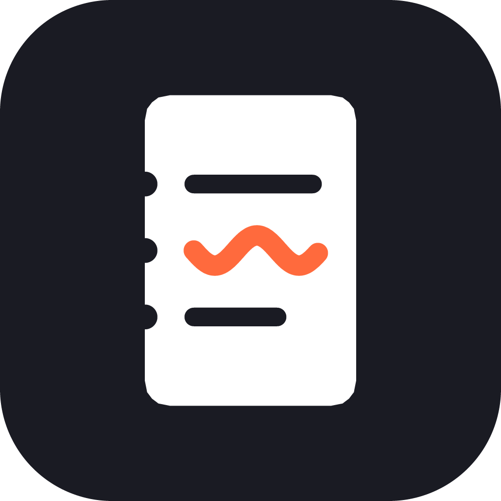
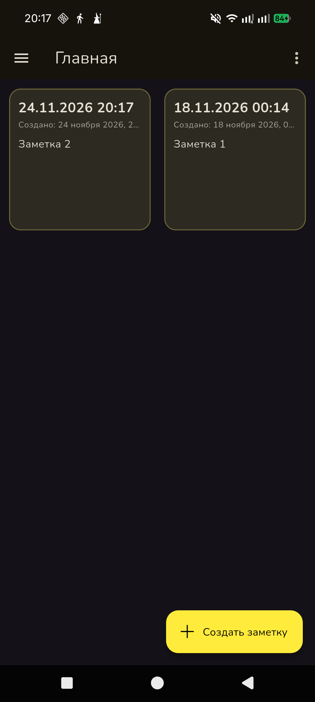
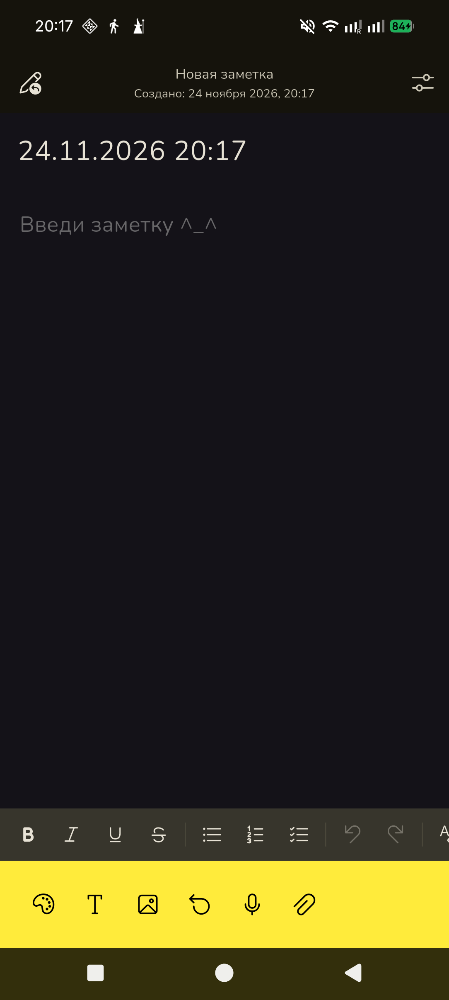
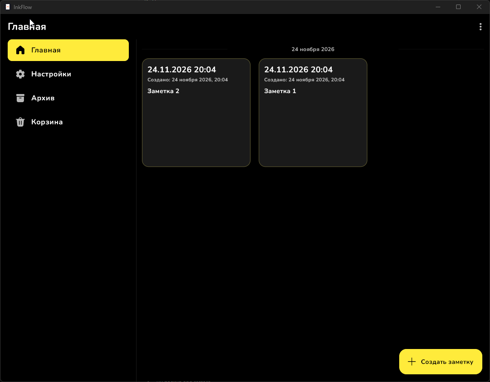

<p align="center">
  
</p>

<h1 align="center">InkFlow</h1>

<p align="center">
  InkFlow is a lightweight note-taking application built with Flutter. It focuses on offline-first local storage, rich-text formatting, and a clean, distraction-free interface across desktop and mobile devices. All notes and attachments remain stored locally on your device without mandatory accounts or cloud dependencies.
</p>

<p align="center">
  <b>English</b> | <a href="README.ru.md">Русский</a>
</p>

<p align="center">
  <a href="https://github.com/auren0/InkFlow/releases">GitHub Releases</a>
</p>

## Screenshots

### Mobile

| Main screen | Note editor | Navigation menu |
| --- | --- | --- |
|  |  |  |

### Desktop

<p align="center">
  
</p>

## Features

- Rich text editing with headings, bold, italic, underline, strikethrough, bulleted and numbered lists, and interactive TODO checkboxes.
- Reliable autosave with race condition protection, real-time status indicators (saving, saved, unsaved changes, error), and note creation and last modified timestamps.
- Note organization with custom folders, archive, and trash with restore or permanent deletion.
- Fast note search and automatic chronological date grouping.
- File attachments with image previews and built-in voice audio recording and playback.
- Visual customization including light, dark, and system themes, custom accent colors, and multiple font families (Jura, Nunito, Oswald).
- Complete data backup through ZIP export and import of notes and attachments, stored locally via Hive.
- Platform-adapted interactions with right-click context menus on desktop and long-press menus on mobile devices.
- In-app update checker fetching release metadata from GitHub Releases.

## Supported platforms

- Windows: fully supported (tested, portable build and Inno Setup installer).
- Android: fully supported (tested, release APKs with split-per-abi).
- Linux: configured and buildable with CMake.
- Web: configured with responsive layout and disabled browser context menu overrides.
- macOS and iOS: not configured in the repository.

## Getting started

### Prerequisites

- Flutter SDK (3.8.1 or higher)
- Git

### Installation

Clone the repository and fetch dependencies:

```bash
git clone https://github.com/auren0/InkFlow.git
cd InkFlow
flutter pub get
```

### Running

Launch the application on an available device or desktop target:

```bash
flutter run
```

### Building

Build for Windows:

```bash
flutter build windows --release
```

Build split APKs for Android:

```bash
flutter build apk --release --split-per-abi
```

Pre-built binaries for Windows and Android are available on the [GitHub Releases](https://github.com/auren0/InkFlow/releases) page.

## License

This project is licensed under the MIT License.
