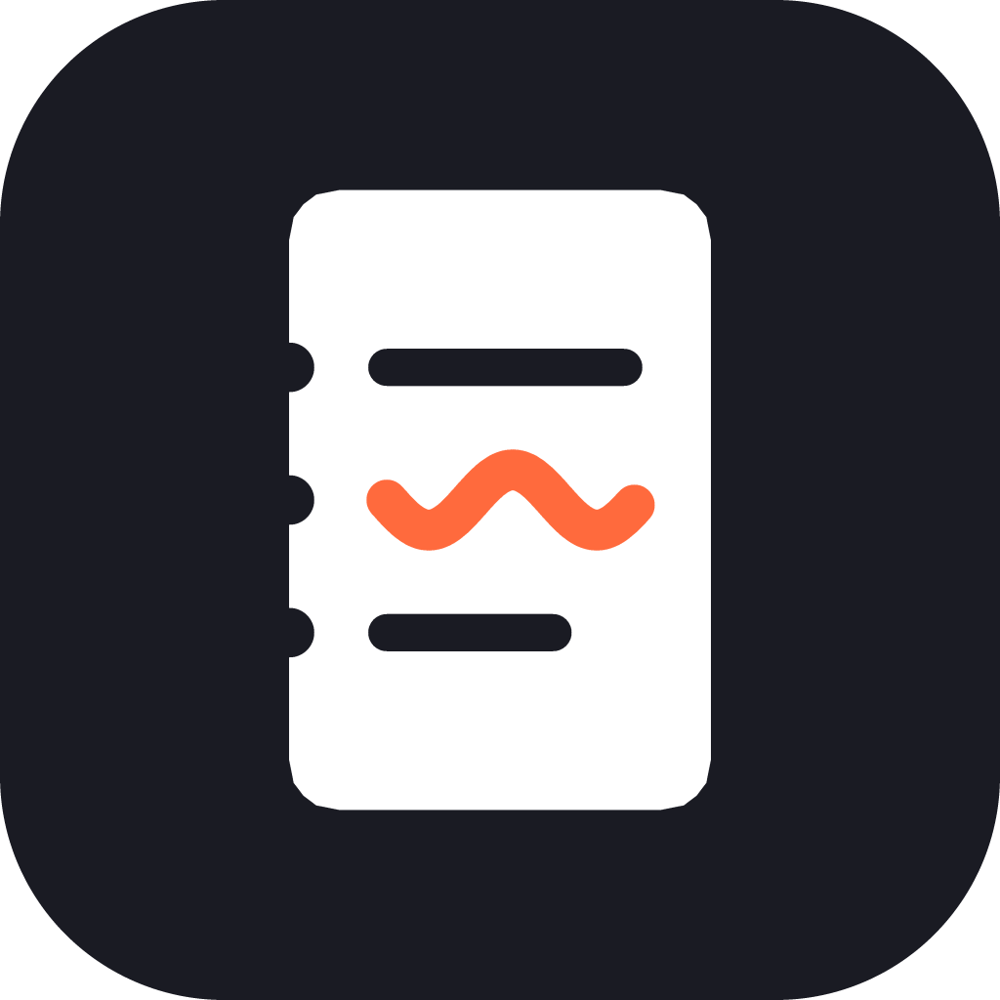
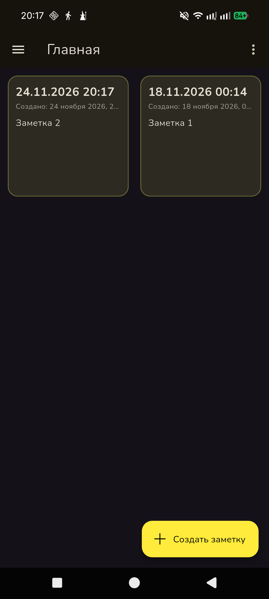
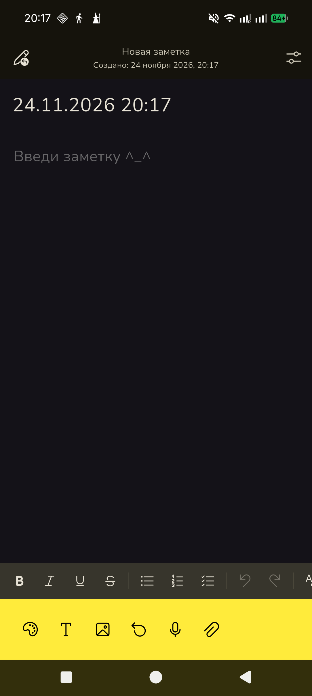
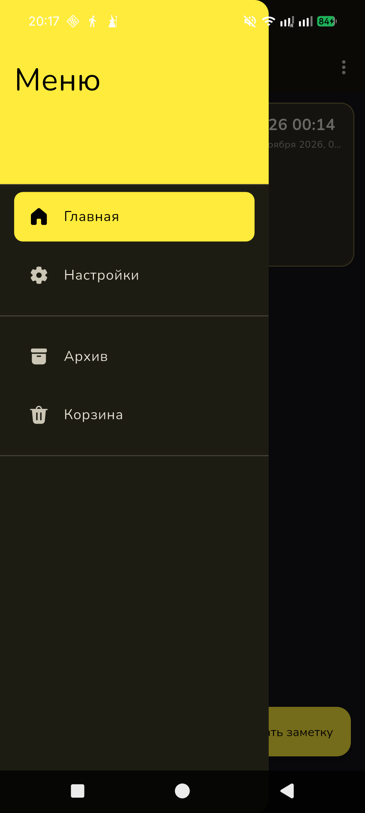

<p align="center">
  
</p>

<h1 align="center">InkFlow</h1>

<p align="center">
  InkFlow — легковесное приложение для заметок, созданное на Flutter. Проект ориентирован на локальное хранение данных, удобное форматирование текста и аккуратный интерфейс для десктопных и мобильных платформ. Все заметки и вложения хранятся исключительно на устройстве пользователя, без обязательной регистрации и сторонних облачных сервисов.
</p>

<p align="center">
  <a href="README.md">English</a> | <b>Русский</b>
</p>

<p align="center">
  <a href="https://github.com/auren0/InkFlow/releases">GitHub Releases</a>
</p>

## Скриншоты

### Мобильная версия

| Главный экран | Редактор заметки | Боковое меню |
| --- | --- | --- |
|  |  |  |

### Десктопная версия

Скриншоты десктопной версии будут добавлены по мере готовности.

## Возможности

- Редактор форматированного текста: заголовки, полужирный, курсив, подчёркивание, зачёркивание, списки и интерактивные TODO-чекбоксы.
- Надёжное автосохранение с защитой от гонок, индикатором статуса записи и отображением времени создания и сохранения.
- Структурирование заметок: пользовательские папки, архив и корзина с восстановлением или окончательным удалением.
- Быстрый поиск по содержимому и автоматическая группировка записей по датам.
- Поддержка вложений: прикрепление изображений, произвольных файлов, а также запись и воспроизведение голосовых заметок.
- Персонализация интерфейса: светлая, тёмная и системная темы, выбор акцентного цвета и шрифтов (Jura, Nunito, Oswald).
- Резервное копирование: полный экспорт и импорт заметок вместе с файлами в формате ZIP (локальное хранилище Hive).
- Адаптация под платформы: контекстное меню по правому клику мыши на Desktop и долгое нажатие на сенсорных экранах.
- Встроенная проверка наличия новых версий приложения через GitHub Releases.

## Поддерживаемые платформы

- Windows: полная поддержка (проверена сборка, портативная версия и установщик Inno Setup).
- Android: полная поддержка (проверена сборка релизных APK с разделением по ABI).
- Linux: проект сконфигурирован и собирается через CMake.
- Web: проект сконфигурирован с поддержкой адаптивного макета.
- macOS и iOS: платформенные директории в репозитории не настроены.

## Начало работы

### Требования

- Flutter SDK (версии 3.8.1 или выше)
- Git

### Установка

Клонируйте репозиторий и загрузите зависимости:

```bash
git clone https://github.com/auren0/InkFlow.git
cd InkFlow
flutter pub get
```

### Запуск

Запустите проект на подключённом устройстве или в среде рабочего стола:

```bash
flutter run
```

### Сборка

Сборка для Windows:

```bash
flutter build windows --release
```

Сборка split APK для Android:

```bash
flutter build apk --release --split-per-abi
```

Готовые файлы установки для Windows и Android доступны в разделе [GitHub Releases](https://github.com/auren0/InkFlow/releases).

## Лицензия

Проект распространяется под лицензией MIT.
